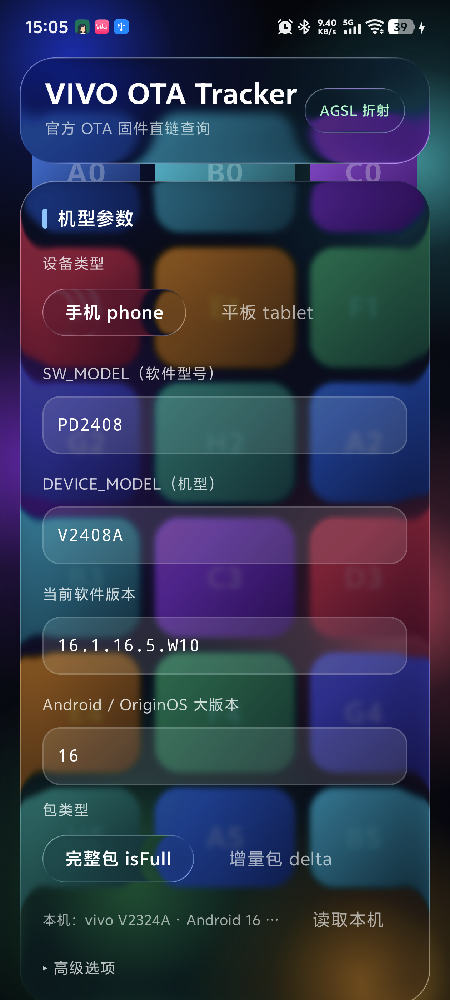

# VIVO OTA Tracker · Android

[VIVO-OTA-Tracker](https://github.com/JerryTse-OSS/VIVO-OTA-Tracker) 的 Android 移植版：把官方 OTA 查询协议
（AES-128-CBC + 16 字节自定义头的 `jvq_param` 加密包）搬到手机上，直接取固件下载直链。
界面是**液态玻璃**（Kyant `backdrop`，和酷安 16.6.1 同款），背景支持 **Bing 每日一图**、
**本地相册图片**和**内置色块**三种，切换带玻璃滑块动画。

协议部分（`crypto/` `net/` `data/`）是该 Python 实现的**逐行移植并做了修改**，
按上游的 Apache License 2.0 发布，详见 [§ 许可](#十许可) 与 [`NOTICE`](NOTICE)。

已在一台 **vivo X100 Pro（V2324A / PD2324，Android 16 / API 36）** 上真机验证，成功取到真实固件直链：

```
版本    16.2.13.1.W10.V000L1
文件    20260909001425000ce8cfaa4c5b70b9e63ee7eebbf52b.zip
大小    10,071,383,898 字节 · 9604 MB
直链    https://sysuptxdl.vivo.com.cn/upgrade/oem/files/20260909001425000ce8cfaa4c5b70b9e63ee7eebbf52b.zip
```

| 截图 | 说明 |
|---|---|
| [`docs/bg-bing.png`](docs/bg-bing.png) | Bing 每日一图背景（含图片版权信息） |
| [`docs/bg-local.png`](docs/bg-local.png) | 本地相册图片背景 |
| [`docs/app-result.png`](docs/app-result.png) | 查询结果卡片：真实固件名 / 大小 / 下载直链 |
| [`docs/app-protocol-debug.png`](docs/app-protocol-debug.png) | verbose 模式下的明文请求参数与解密后的原始响应 |

---

## 一、功能

| 功能 | 说明 |
|---|---|
| 官方 OTA 直链查询 | 手机 / 平板两种设备分支，参数和原 Python 版逐字段一致 |
| 读取本机 | 一键从 `ro.build.*` 读出 SW_MODEL / DEVICE_MODEL / 当前版本 / 设备类型 |
| 完整包 / 增量包 | `isFull` 开关 |
| verbose 调试 | 展示明文请求参数与解密后的原始 JSON（排查「没有更新」必备） |
| 背景三选一 | Bing 每日一图 / 本地图片 / 内置色块，选择会持久化 |
| 复制 / 打开链接 | 拿到直链后可一键复制或交给浏览器下载 |
| 液态玻璃 UI | 真折射（AGSL `lens()`），不是普通毛玻璃 |

## 二、协议是怎么搬过来的

原项目是 Python CLI，核心逻辑全在 `VivoOtaTracker.py` 的 781 行里。移植是一比一对照做的：

| Python | Kotlin |
|---|---|
| `aes_encrypt` / `aes_decrypt` | [`crypto/VivoProtocol.kt`](app/src/main/java/com/leehe/vota/crypto/VivoProtocol.kt) |
| `build_protocol_package` / `extract_encrypted_body` | 同上 |
| `encrypt_to_jvq` / `decrypt_response` | 同上 |
| `http_post`（requests + 自定义 SSLAdapter） | [`net/OtaHttpClient.kt`](app/src/main/java/com/leehe/vota/net/OtaHttpClient.kt) |
| `build_request_params` / `parse_update_response` | [`data/OtaRepository.kt`](app/src/main/java/com/leehe/vota/data/OtaRepository.kt) |
| `DeviceConfig` / `UpdateInfo` | [`data/OtaModels.kt`](app/src/main/java/com/leehe/vota/data/OtaModels.kt) |

### 协议本身

```
请求体      jvq_param = base64url( [2B 头长][8B CRC32][头字段][AES-128-CBC(PKCS7) 明文] )
头字段      [2B 版本=1][1B token 长][token][2B keyVersion][1B msgType=5]
token       jnisgmain_v2@com.bbk.updater
id          IV 与两把 key 来自对 libvivoseckey_n4.so 的逆向（原项目常量）
响应        同样结构，base64url 解码 → 跳过头 → AES 解密 → 紧凑 JSON
明文参数    key=value&key=value…（**不做 URL 编码**，服务端只认这种形态）
```

下载直链不用再走 `pk/redirPost.do`，直接由响应里的 `pkName` 拼出（与原实现相同）：

```
https://sysuptxdl.vivo.com.cn/upgrade/oem/files/<pkName>
```

### 移植时踩到的三个点

1. **`http_post` 必须绕开 OkHttp。** 官方服务端 TLS 配置偏旧，Python 版为此专门写了
   `SSLAdapter`（`set_ciphers('DEFAULT:@SECLEVEL=1')` + `verify=False`）。
   这里用标准库 `HttpURLConnection` + 自定义 `X509TrustManager` 达到同样效果，**不引入 OkHttp**。
   > ⚠️ 这是有意的：**该请求不校验服务端证书**，与原项目行为一致。只在查询官方接口时使用。
   > Bing 图片走的那条 HTTP 路径（`data/BingWallpaper.kt` 里的 `Http`）是正常校验证书的，两条链路互不影响。
2. **响应里的 URL 是 JSON 转义的**（`https:\/\/…`）。原实现有 `normalize_json_url()`，
   第一版移植时漏了，单元测试直接抓出来了 —— 见 `response parsing extracts firmware fields`。
3. **`isFull` 在查询串里是 `1`/`0`**，不是 `true`/`false`；平板的 `ms` 是 `-1`，
   手机的 `ms` 是 `0`。这些差异照着原表抄，不能凭直觉改。

## 三、背景

[`data/BingWallpaper.kt`](app/src/main/java/com/leehe/vota/data/BingWallpaper.kt) ·
[`data/BackgroundStore.kt`](app/src/main/java/com/leehe/vota/data/BackgroundStore.kt) ·
[`ui/TrackerScreen.kt`](app/src/main/java/com/leehe/vota/ui/TrackerScreen.kt) 的 `BackgroundSurface`

### Bing 每日一图（跟随官方 API）

```
接口    https://www.bing.com/HPImageArchive.aspx?format=js&idx=0&n=8&mkt=zh-CN
        idx=0 是今天，idx=1 是昨天……n 最大 8
图片    https://www.bing.com<th urlbase>_1920x1080.jpg   （还有 _UHD / _400x240 档位）
```

几个实现细节：

- **接口与图片都无 key、无配额**，只解析 `startdate` / `urlbase` / `copyright` 三个字段。
  `urlbase` 拼上档位后缀就是图；`copyright` 直接显示在背景面板上（含 © 署名）。
- **「换一张」先翻本地缓存的最近 8 天**（切换是瞬时的，图片已按 URL 哈希落在 `cacheDir/bg`），
  翻到底才重新拉接口。这样连点也不会打满网络。
- **跨天自动换**：把成功拉取那天的 `yyyyMMdd` 存进 SharedPreferences，
  启动或回到前台时发现日期变了才重新请求接口 —— 一天最多一次 API 调用。
- **失败不破坏界面**：接口挂掉时保留当前背景，面板上给一行 `⚠` 提示；一张图都没有才回落到内置色块。
- **采样解码**：`BitmapFactory` 两遍解码（先读尺寸算 `inSampleSize`，再按 1440px 长边解），
  4K 原图不会整张进内存。不引 Coil 之类的图片库，省一个依赖。

### 本地图片

用 **Photo Picker**（`ActivityResultContracts.PickVisualMedia`）选图，**不需要任何存储权限**。
选完把图片拷进 `filesDir/background/local_image.jpg`，只存路径 ——
不依赖长期 URI 授权，重启、换相册 App、清理媒体库都不会让背景失效。

### 内置色块

不联网、折射最明显的那套彩色色块阵列，用来看玻璃边缘把内容「挤压/放大」最清楚。

## 四、液态玻璃与动画

用的是 [`io.github.kyant0:backdrop`](https://github.com/Kyant0/AndroidLiquidGlass) 2.0.1 —— 酷安 16.6.1 同款
（分析见姊妹仓库 `liquidglassdemo/docs/coolapk-liquid-glass-analysis.md`）。三段式 API：

```kotlin
// 1) 录制背景：底色 + 被标记子树的内容
val backdrop = rememberLayerBackdrop {
    drawRect(InkBlack)
    drawContent()
}

// 2) 标记来源：这个子树会被录进 backdrop
BackgroundSurface(backdrop = backdrop, bitmap = bitmap, modifier = Modifier.fillMaxSize())

// 3) 画玻璃：效果按调用顺序叠加
Modifier.glassSurface(backdrop, RoundedCornerShape(28.dp))
```

[`ui/Glass.kt`](app/src/main/java/com/leehe/vota/ui/Glass.kt) 里的效果顺序是
**`blur → vibrancy → lens`**：

```kotlin
effects = {
    blur(7.dp.toPx())        // 2.0.1 的 blur 收的是 Float 像素值，不是 Dp
    vibrancy()               // 提亮/提饱和
    lens(                    // 真折射：AGSL / RuntimeShader，API 33+
        refractionHeight = 28.dp.toPx(),   // 折射带宽度
        refractionAmount = 48.dp.toPx(),   // 折射强度
        depthEffect = true,                // 中心透镜畸变
        chromaticAberration = false,
    )
}
onDrawSurface = { drawRect(Color(0xFF0B1020).copy(alpha = 0.52f)) }  // 深色底
```

三个和观感有关的决定：

- **背景必须「静止 + 有对比」**。所以整页固定一屏、表单不做滚动列表；图片背景会盖一层
  `ImageScrimAlpha = 0.42` 的黑色 scrim —— 图片直接透上来会盖掉白字，折射也需要干净的中低亮度底子。
   那版（内置色块）折射最明显，就是因为它对比最高。
- **玻璃面板自带深色底**（`surfaceAlpha ≈ 0.5`）。第一版照搬 demo 的 `Color.White.copy(0.06f)`，
  结果彩色背景把白字全淹了。
- **`lens()` 需要 API 33+**（`RuntimeShader`）。低版本库内部直接跳过，只剩模糊；
  顶栏的 `AGSL 折射 / 仅模糊` 芯片就是拿 `isRuntimeShaderSupported()` 显示这个降级的。

### 切换动画

同一个 `GlassSegmentedControl` 用在了**背景来源**、**设备类型**、**包类型**三处：

| 元素 | 动画 |
|---|---|
| 选中滑块 | `animateDpAsState` + `spring(dampingRatio = 0.72, stiffness = 420)`，收尾带一点回弹 |
| 滑块宽度 | `animateDpAsState` + `tween(220)`（按分段宽度自适应，切换瞬间不突跳） |
| 文字颜色/字重 | `animateColorAsState` + `tween(220)` |
| 背景图切换 | `AnimatedContent` + 交叉淡入淡出（520ms in / 380ms out） |
| 右上角动作按钮 | `AnimatedContent` 淡入淡出（「换一张」↔「选择图片」↔「不联网」） |
| 版权/提示行 | `AnimatedContent` + `slideInVertically`，面板高度变化不突兀 |

滑块本身是玻璃面板，所以**滑动的过程中背景会被实时折射** —— 这是这套动画的重点。
实现上滑块和点击区域必须同层，因此用 `BoxWithConstraints` 自己算每个分段的偏移，
而不是依赖 `Row` 的 `weight`。

## 五、构建与安装

```bash
# 需要 JDK 17（用 Android Studio 自带的 JBR 即可）
$env:JAVA_HOME="C:\Program Files\Android\Android Studio\jbr"

./gradlew :app:assembleDebug      # debug（applicationId 带 .debug 后缀）
./gradlew :app:assembleRelease    # release（本机配了签名才会签名）
./gradlew :app:testDebugUnitTest  # 10 个单元测试
./gradlew :app:installDebug
```

产物：`app/build/outputs/apk/{debug,release}/`

### 签名（两种来源，密钥都不入库）

`app/build.gradle.kts` 按下面的顺序找签名，都找不到时 release 变体**不打签名**（debug 不受影响）：

1. **本地**：项目根目录的 `keystore.properties`（已在 `.gitignore` 里）

   ```properties
   storeFile=/path/to/your/keystore.jks
   storePassword=****
   keyAlias=****
   keyPassword=****
   ```

2. **环境变量**：`VOTA_STORE_FILE` / `VOTA_STORE_PASSWORD` / `VOTA_KEY_ALIAS` / `VOTA_KEY_PASSWORD`

3. **CI（base64 keystore）**：`KEYSTORE_BASE64` 是 keystore 的 base64，
   workflow 会解到 `$RUNNER_TEMP/release.keystore`，再自动设好上面那组 `VOTA_*` 变量。

> 这个 keystore 是 **PKCS12**，`storePassword` 与 `keyPassword` 可以不同 ——
> 两者填错会报 `Get Key failed: Given final block not properly padded`，
> 用 `KeyStore.getEntry(alias, PasswordProtection(...))` 可以逐个试出正确口令。

### 版本号

- 本地构建：`versionCode 1` / `versionName 1.0`（`app/build.gradle.kts` 里的默认值）
- 打 tag 的 CI 构建：`versionName = <tag 去掉 v>`，`versionCode = git rev-list --count HEAD`

```bash
git tag v1.0.0 && git push origin v1.0.0   # 触发 CI 编译 + 发布 Release
```

## 六、CI（GitHub Actions）

[`.github/workflows/main.yml`](.github/workflows/main.yml)

| 触发 | 行为 |
|---|---|
| push tag `v*` | 跑单元测试 → 编译 release APK → 建 Release 并附上 APK |
| push `main` | 同上，但只上传 artifact（保留 7 天），不发 Release |
| 手动 `workflow_dispatch` | 同上 |

发版就是打个 tag：

```bash
git tag v1.0.0 && git push origin v1.0.0
```

在仓库 Secrets 里需要这几个（Settings → Secrets and variables → Actions）：

| Secret | 内容 |
|---|---|
| `KEYSTORE_FILE` | keystore 的 **base64**：`[Convert]::ToBase64String([IO.File]::ReadAllBytes('keystore.jks'))`；带 `-----BEGIN CERTIFICATE-----` 的 PEM 包装同样可以 |
| `KEYSTORE_PASSWORD` | store 口令 |
| `KEY_ALIAS` | key 别名 |
| `KEY_PASSWORD` | key 口令（PKCS12 下可以与 store 口令不同） |

### 三个在 CI 上翻过车的点，workflow 里都处理了

1. **`compileSdk` 是 37.2**，GitHub 托管 runner 自带的 SDK 里没有这个平台。
   workflow 会先把 `platforms;android-37.2` 和 `build-tools;36.0.0` 装上
   （`--licenses` 先接受许可），并把 `sdk.dir` 写进 `local.properties`。
2. **无法从 Google Maven 解析 Android Gradle Plugin 的 marker**（`com.android.application`
   的 plugin marker 不在 `google()` 上）：`settings.gradle.kts` 里加了 `gradlePluginPortal()`，
   它会把请求代理到 `dl.google.com`，workflow 再通过环境变量把
   `MAVEN_GROUP=com.android.tools.build` / `MAVEN_NAME=gradle` / `MAVEN_VERSION=9.2.1`
   传给 runner，让这个代理指向正确的构件。
3. **keystore secret 的形态**。`KEYSTORE_FILE` 里是 PEM（`-----BEGIN CERTIFICATE-----`
   夹着 PKCS12 的 base64）时，`base64 -d` 会直接失败 —— 这个坑踩过一次，
   现在解码前会先剥掉 PEM 头尾和所有空白，两种形态都能吃。
   另外解出文件后立刻用 `keytool -list -storepass ... -alias ...` 自检，
   口令/别名不对当场报错，不会拖到 Gradle 阶段变成一句模糊的签名异常。

签名相关步骤的设计：`Prepare signing keystore` 带 `continue-on-error`，
所以签名配置有问题时**单元测试与编译照跑**（能看出构建本身是否健康），
最后由 `Verify signing config` 把任务标红 —— 未签名的产物不会被当成成功发出去。
错误信息用 `::error title=...` 写成注释，在 Actions 页面直接可见，不必翻日志。

## 七、验证方式

| 手段 | 内容 |
|---|---|
| JVM 单元测试 | `app/src/test/java/com/leehe/vota/ProtocolTest.kt`，覆盖封包布局、CRC、加解密往返、参数派生、响应解析、bbk 版本号解析 |
| Python 交叉校验 | `python tools/protocol_check.py`：直接 import 原项目，打印同样的派生值用于比对 |
| 真机查询 | 在 V2324A 上实跑，取到真实直链（见文首） |
| 真机背景 | Bing 每日一图拉取、8 天缓存翻页、本地相册选图、重启后恢复，均已在真机确认 |

固定明文（PKCS7 后刚好一个 block）的密文，可作为协议未走样的口令：

```
plaintext  61616161616161616161616161616161 ("a"×16)
key_v2     ciphertext 84824093a16e4adc4dad4e74b38cb51014f9edbcbcf9160e91f07bbe04cffc98
```

## 八、工具链（都是踩出来的要求）

| 组件 | 版本 | 原因 |
|---|---|---|
| Gradle | 9.5.1 | AGP 9 要求（wrapper 指向腾讯云镜像，可复用本机缓存） |
| AGP | 9.2.1 | backdrop 2.x 的 AAR 元数据要求 ≥ 9.1.0 |
| compileSdk | **37（minor 2）** | backdrop / Compose 1.12 要求 ≥ 37；本机只有 `android-37.2` |
| Kotlin | 2.4.0 | 依赖库用 kotlin-stdlib 2.3.20+ 编译 |
| Compose BOM | 2026.05.01 | |
| backdrop | 2.0.1 | |
| minSdk / targetSdk | 26 / 36 | `lens()` 在 API < 33 自动降级为模糊 |

两个非显然的点：

1. **AGP 9 内置 Kotlin 支持**，不能再应用 `org.jetbrains.kotlin.android` 插件；
   `org.jetbrains.kotlin.plugin.compose` 仍需保留。`kotlinOptions {}` 也不可用，改用
   `kotlin { compilerOptions { jvmTarget } }`。
2. 本机只有 `android-37.2`，`compileSdk` 要用带 minor 的 DSL，并在 `gradle.properties` 里
   加 `android.suppressUnsupportedCompileSdk=37.2` 消掉 AGP 的告警。

## 九、免责声明

仅供技术学习与交流，请勿用于任何非法或商业用途。查询结果来自官方服务端，
返回「没有更新」（retcode 210）不代表设备一定没有新版本 —— 常见原因是所填版本不在
官方开放升级名单内、推送名额已满或触发了限流。

Bing 每日一图的图片版权归 Microsoft / 原作者所有，本应用仅按 Bing 官方接口展示。

## 十、许可

本项目采用**双许可**，按代码来源区分：

| 范围 | 许可 | 文件 |
|---|---|---|
| 本项目的原创部分：Compose 界面、液态玻璃表现层、背景来源、ViewModel、构建与 CI 配置 | **MIT** | [`LICENSE`](LICENSE) |
| 协议移植部分：`crypto/VivoProtocol.kt`、`data/OtaRepository.kt`、`net/OtaHttpClient.kt`（以及仅用于校验、不随应用分发的 `tools/protocol_check.py`） | **Apache-2.0** | [`LICENSES/Apache-2.0.txt`](LICENSES/Apache-2.0.txt) |

```
MIT License (本项目原创部分)
Copyright (c) 2026 leehe-byte

Apache License, Version 2.0 (协议移植部分)
Copyright 2026 leehe-byte
包含来自 VIVO-OTA-Tracker 项目（https://github.com/JerryTse-OSS/VIVO-OTA-Tracker）
的代码，按 Apache License 2.0 授权。
```

上游 [JerryTse-OSS/VIVO-OTA-Tracker](https://github.com/JerryTse-OSS/VIVO-OTA-Tracker)
以 **Apache License 2.0** 发布。协议移植属于其衍生作品，因此这部分保留 Apache-2.0，
并履行该许可 §4 的义务：附许可证副本、标明改动过的文件、保留署名。

- 逐文件的改动说明与上游对应关系：[`NOTICE`](NOTICE)
- 移植文件头部带 `SPDX-License-Identifier: Apache-2.0` 标记

MIT 与 Apache-2.0 兼容（Apache-2.0 允许再以 MIT 分发），但**转载或二次分发时请同时保留
`LICENSE`、`LICENSES/Apache-2.0.txt` 与 `NOTICE` 三份文件**，不要只保留 MIT。

> 上游 Apache-2.0 覆盖的是其自身代码。协议里的 AES 密钥与 IV 是上游从
> `libvivoseckey_n4.so` 逆向得到的，这部分与上游许可无关，本项目沿用其数值但不做额外主张。


